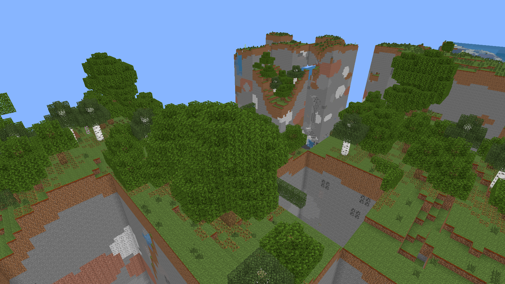

# Bedrock Forge

**A world editor for Minecraft Bedrock Edition, running inside the Unity Editor.**



Bedrock Forge opens your Bedrock worlds, shows them in 3D in Unity's Scene view with the game's own textures, and
lets you edit almost everything that has a value: blocks, world settings, the player, inventories, mobs, chests and
any NBT data. All the reading and writing code is plain C# (no native DLLs), including Mojang's modified LevelDB.

> Bedrock Forge is not an official Minecraft product. It is not approved by or associated with Mojang or Microsoft.

## Features

- **Installed world list**: icon, game mode, size, last played date. Open a **copy** (recommended) or the original,
  import a `.mcworld`, or open any world folder.
- **3D rendering in the Scene view**: textures read from the installed game, slabs, stairs, fences, walls, glass
  panes, plants, transparent water, ambient occlusion.
- **Scene view tools**: Select, Break, Place (left click), pick block (Ctrl+click), shortcuts 1 / 2 / 3, clickable
  entity markers.
- **Editing panel** (tabs):
  - **World**: name, game mode, difficulty, cheats, hardcore, seed, time, weather, world spawn, game rules, and the
    whole `level.dat`.
  - **Player**: game mode, dimension, position, health, hunger, level, XP, abilities (flying, invulnerability…),
    inventory, armor, offhand, ender chest.
  - **Mobs**: filterable list, custom name, position, health, baby, tamed…, equipment, deletion.
  - **Block**: states of the selected block, contents of chests / furnaces / hoppers, block to place.
  - **Data**: every other NBT record (scores, villages, maps, portals…).
  - Everywhere, an **NBT editor** lets you change, delete or add any value.
- **Safe saving**: refused while the world is open in Minecraft, full `.mcworld` backup before every write (in
  `Documents\Bedrock Forge\Backups`), changes appended the same way the game itself writes them.

## Installation

1. Install **Unity 6000.3** (tested with 6000.3.13f1) through Unity Hub.
2. Clone this repository, then add the `BedrockForge.Unity` folder in Unity Hub (*Add project from disk*).
3. In Unity: **Tools → Bedrock Forge** (or `Ctrl+Shift+B`).

**Minecraft Bedrock for Windows** must be installed for textures. Without it, blocks are drawn with flat colors.
No game assets are included in this repository: textures are read from your installation when a world is opened.

## Usage

1. Close the world in Minecraft (or quit the game).
2. **Tools → Bedrock Forge**, pick a world, then **Open a copy**: the copy also shows up in the game's world list.
3. The world appears in the Scene view. Navigate as usual in Unity (right click + WASD, mouse wheel, F to frame).
   Choose a tool in the bar at the bottom of the Scene view ("Unity" gives control back to Unity).
4. Edit anything in the panel, then **Save**.
5. Open the copy in Minecraft.

## Project layout

```
BedrockForge.Unity/Assets/BedrockForge/
  Core/        BedrockForge.Core: Bedrock formats, no Unity dependency
               LevelDb (Mojang fork: zlib/raw deflate, .ldb, .log, MANIFEST, writing),
               Nbt (little-endian), Bedrock (keys, sub-chunks, entities, edit session, world list),
               Resources (game packs: .brarchive, blocks.json, terrain_texture.json, TGA)
  Rendering/   BedrockForge.Rendering: block models, textures, mesher, world view
  Editor/      BedrockForge.Editor: window, UI Toolkit panel, Scene view tools
  Shaders/     URP shaders (opaque, cutout, transparent)
cli/           command-line tool (.NET 10) compiling the same Core sources
docs/images/   README screenshots
```

## Developer tools

```
cd cli
dotnet run --project BedrockForge.Cli -- info <world-folder>
dotnet run --project BedrockForge.Cli -- textures <world-folder>
dotnet run --project BedrockForge.Cli -- edit-selftest <world-folder> <scratch-folder>
```

`edit-selftest` copies a world, edits it (game mode, blocks, player, a mob), saves, reopens it and checks every
change. In Unity, `BedrockForge.EditorTools.DevCapture.BatchSmokeTest` loads a world in batch mode, places a block,
builds every panel tab and renders an image.

## Known limitations

- Writes are verified by reading the worlds back with Bedrock Forge: **always try on a copy first**.
- Placing a block that never appears in the world creates it without states: if it needs some (orientation,
  color…), the game may show it as an unknown block. Picking an existing block (Ctrl+click) keeps its exact states.
- No undo (Ctrl+Z) for world edits yet: "Discard all" reloads from disk.
- Simplified shapes for doors, trapdoors and wall torches; stair corners are not computed.
- Marketplace worlds (encrypted) and very old worlds (before 1.2.13) are not supported.
- The whole database is loaded in memory: suited to small and medium worlds.

## License

[MIT](LICENSE)
